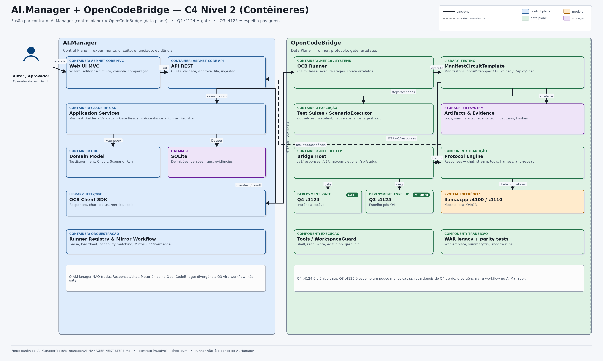

> **Espelho sincronizado do repositório AI.Manager.**
> Fonte canônica: `AI.Manager/docs/ai-manager/AI-MANAGER-NEXT-STEPS.md`, commit `f13bc2f` (2026-10-25).
> Este arquivo é somente leitura no OpenCodeBridge; alterações de plano devem ser feitas no AI.Manager e sincronizadas por commit.

# AI.Manager Next Steps — fusão por contrato com o OpenCodeBridge

> **Status:** proposta arquitetural aprovada para implementação incremental  
> **Data:** 2026-10-25  
> **Escopo:** consolidar o AI.Manager como plano de controle do Test Bench e o OpenCodeBridge como plano de execução do mesmo circuito  
> **Fora de escopo nesta fase:** execução remota, reescrita do motor de protocolo, alteração do gate WAR/Q4

---

## 1. Sumário executivo

A evolução correta não é fundir os dois repositórios em um monólito, nem mover a tradução de protocolo para dentro do AI.Manager. A direção recomendada é uma **fusão por contrato**:

- **AI.Manager = plano de controle.** Gerencia o experimento de teste, o circuito, o enunciado, as assertions, a versão aprovada, o runner alvo, a fila, a evidência e a aceitação.
- **OpenCodeBridge = plano de execução.** Continua dono do motor de protocolo, do `TestCircuitDriver`, do gate, dos artefatos e da pipeline WAR.
- **Contrato = manifesto imutável + resultado/evidência.** O AI.Manager monta o manifesto; o runner do OpenCodeBridge valida, executa e devolve o resultado. O runner nunca lê o banco do AI.Manager.
- **SDK = cliente + contratos.** O AI.Manager consome `Rochas.OpenCodeBridge.Client` e `Rochas.OpenCodeBridge.TestContracts`. Não reimplementa Responses/chat.
- **Gate continua no OpenCodeBridge.** O AI.Manager armazena e exibe o gate, mas não o recalcula. Q4 `:4124` é gate; Q3 `:4125` é espelho pós-green.

Em uma frase: **o AI.Manager manda no “o quê”; o OpenCodeBridge manda no “como” e no veredito.**

---

## 2. Evidências do estado atual

1. **O motor duplicado do AI.Manager não está no caminho da API.**  
   `Rochas.AI.Manager.Bridge` contém tradução, stream e anti-repeat, mas é referenciado apenas por `Web/Data/BridgeFeatureSeeder.cs` e pelos testes. O `BindingBridgeController` continua encaminhando HTTP para `:4124`/`:4125`. Ou seja: o motor local não é o artefato que o gate testa.

2. **O pipeline real do OpenCodeBridge está no host, não no `Core`.**  
   `Rochas.OpenCodeBridge/Program.cs` tem ~245 KB e concentra perfis, harness, breaker, permissões, coerção, shim, stream, tool loop e telemetria. O `Core` tem peças reutilizáveis, mas não um orquestrador coeso. Uma extração big-bang colocaria o gate Q4 em risco sem necessidade.

3. **O `TestCircuitDriver` já é o kernel certo.**  
   Ele suporta DAG (`DependsOn`), condicionais (`When`), ramificação (`NextSteps`), paralelismo limitado, N builds/deploys, retry/restart, lock, pausa/retomada, artefatos e `GatePolicy`. Falta apenas o adaptador de manifesto.

4. **O WAR atual é codificado, mas tem a semântica que o AI.Manager precisa.**  
   `WarTemplate` fixa 3 níveis, 2 modos (`bridge`/`opencode`), 5 belts, Q4/Q3, filtros `--only`/`--belts`, preflight, build e gate. Modelar cada combinação como caso separado criaria uma matriz de ~60 cenários. O correto é modelar dimensões.

5. **A evidência atual está incompleta.**  
   O proxy grava `HarnessRun` com `ProfileVersionId=0` e `EvidenceId=0`. O novo modelo deve vincular experimento, versão, manifesto, runner, harness, modelo, gate e evidência reais.

---

## 3. Decisão arquitetural

### 3.1 Planos e fronteiras

```text
┌────────────────────────────────────┐
│ AI.Manager — Control Plane         │
│  Web/API, domínio de teste, SQLite │
│  manifesto, aprovação, evidência   │
└───────────────┬────────────────────┘
                │ manifesto imutável (HTTP ou arquivo)
                ▼
┌────────────────────────────────────┐
│ OpenCodeBridge — Data Plane        │
│  Runner, TestCircuitDriver, gate   │
│  Bridge Host, protocolo, llama     │
└────────────────────────────────────┘
```

O runner é um processo separado da bridge. Ele não roda dentro do host HTTP da bridge e não compartilha o banco do AI.Manager.

### 3.2 O que significa “SDK” neste projeto

Há dois significados possíveis:

| Interpretação | Recomendação |
|---|---|
| Cliente tipado da bridge (HTTP/SSE) + contratos de teste | **Adotar** |
| Motor de tradução executando dentro do AI.Manager | **Não adotar agora** |

O `Rochas.AI.Manager.Bridge` atual é uma tentativa do segundo modelo e está incompleto em relação ao host (permissões, breaker, shim, tool loop, perfis, sampler, sanitização). Usá-lo como SDK canônico criaria uma segunda implementação divergente. O caminho correto é:

- `Rochas.OpenCodeBridge.Client`: cliente HTTP/SSE para `/v1/responses`, `/v1/chat/completions`, `/api/status`, `/api/metrics`, `/api/tools/execute`.
- `Rochas.OpenCodeBridge.TestContracts`: DTOs, JSON Schema, validação e checksum do manifesto/resultado.
- `Rochas.OpenCodeBridge.Testing`: driver genérico + `ManifestCircuitTemplate` + executor de cenário nativo.
- `Rochas.OpenCodeBridge.Runner`: console/systemd que referencia `Testing` e `TestContracts`.

Se no futuro o AI.Manager precisar operar sem processo da bridge, aí sim se extrai `Rochas.OpenCodeBridge.Protocol` do host, com o host consumindo o mesmo pacote e testes de paridade. Esse é um épico separado e não resolve o controle de testes.

### 3.3 Fonte única por fato

| Fato | Fonte única |
|---|---|
| Definição do experimento, circuito, cenário e assertions | AI.Manager (banco/UI) |
| Versão aprovada, checksum e assinatura | AI.Manager |
| Manifesto executável | AI.Manager gera; OpenCodeBridge valida |
| Execução, veredito de step e gate | OpenCodeBridge runner |
| Protocolo/tradução | OpenCodeBridge bridge |
| Evidência bruta | OpenCodeBridge produz; AI.Manager armazena metadados |
| Aceitação/rejeição do experimento | AI.Manager |

O runner **nunca lê o banco do AI.Manager**. Ele recebe o manifesto e devolve resultado. Isso evita acoplamento, lock de SQLite, duplicação de regra e permite execução remota depois.

### 3.4 Q4 primeiro; Q3 é espelho pós-green, não gate

O fluxo oficial desta fase é:

1. **Montar a pipe WAR como dados no AI.Manager**, apontando para o perfil **Q4 `:4124`** (gate).
2. **Rodar o Q4** e exigir gate verde. O Q4 é a única autoridade de aceite.
3. **Só depois do Q4 verde**, executar o **mesmo manifesto** (mesmo `manifestHash`) no perfil **Q3 `:4125`**.
4. O Q3 é um **espelho um pouco menos capaz**: deve acompanhar o green do Q4 na sequência. Ele não aprova, não reprova e não substitui o gate.
5. Se houver divergência entre Q4 e Q3, o AI.Manager abre um item de **workflow de ajuste** (`MirrorDivergence`) com classificação, dono e ação. A correção é feita na pipe/cenário/configuração e revalidada primeiro no Q4; depois o espelho Q3 é repetido.

**Testes manuais desta fase são diagnóstico, não aceite.** Eles ajudam a explicar divergências e a calibrar o espelho, mas não viram critério de green, não substituem assertion automatizada e não podem ser usados para “compensar” um Q4 vermelho. A aceitação continua automatizada: Q4 verde + evidência + política de aprovação.

O Q3 pode divergir por capacidade menor (contexto, tokenizer, tool calling, stream, aderência ao formato). Essas divergências são esperadas em parte; o que importa é que sejam **classificadas e tratadas no workflow**, não escondidas no gate.

---

## 4. Diagrama C4

### 4.1 Nível 1 — Contexto

- **Pessoa:** autor/aprovador/operador gerencia experimentos e acompanha execuções pela UI.
- **Sistema AI.Manager:** fonte de verdade do experimento, do circuito, do enunciado e da evidência.
- **Sistema OpenCodeBridge:** executa o circuito, traduz o protocolo e calcula o gate.
- **Sistema externo llama.cpp:** serve o modelo local em Q4 (`:4100`) ou Q3 (`:4110`).
- **Sistema externo GitHub:** versiona documentos, contratos e código dos dois repositórios.

### 4.2 Nível 2 — Contêineres



Arquivos:

- `docs/ai-manager/diagrams/ai-manager-next-steps-c4.drawio` — especificação editável para draw.io.
- `docs/ai-manager/diagrams/ai-manager-next-steps-c4.png` — export em alta definição (4000 × 2400).

### 4.3 Contêineres e responsabilidades

| Contêiner | Responsabilidade |
|---|---|
| AI.Manager Web UI | Wizard do experimento, editor de circuito/cenário, console de runs, comparação e evidência |
| AI.Manager API | CRUD, validação, aprovação, manifesto, fila, ingestão de resultado |
| Application Services | Manifest Builder, Validator, Gate Reader, Acceptance, Runner Registry |
| Domain | `TestExperiment`, `TestExperimentVersion`, `CircuitStage`, `CircuitStep`, `TestScenario`, `TestRun`, `MirrorRun`, `MirrorDivergence`, `Evidence` |
| SQLite | Definições, versões, runs, evidências (metadados), audit |
| OCB Client SDK | HTTP/SSE tipado para a bridge; sem SQLite e sem domínio |
| OCB Runner | Claim/lease, executa stages/steps, pausa/retoma, coleta artefatos |
| ManifestCircuitTemplate | Traduz manifesto em `CircuitStepSpec`/`CircuitBuildSpec`/`CircuitDeploymentSpec` |
| TestCircuitDriver | DAG, condicionais, paralelismo, retry, lock, gate e artefatos |
| Test suites / ScenarioExecutor | Passos `dotnet-test`/`web-test` existentes e cenários nativos |
| Bridge Host | `/v1/responses`, `/v1/chat/completions`, `/api/status`, `/api/metrics` |
| Protocol Engine | Tradução Responses ↔ chat, stream, tools, harness, anti-repeat |
| Q4 `:4124` | Instância estável; único gate válido |
| Q3 `:4125` | Espelho um pouco menos capaz; roda depois do Q4 verde; nunca é gate |
| llama.cpp `:4100`/`:4110` | Inferência local |
| Artifacts/Evidence | Logs, `summary.tsv`, `events.jsonl`, capturas, hashes |

### 4.4 Relacionamentos principais

| De | Para | Protocolo | Descrição |
|---|---|---|---|
| Usuário | Web UI | HTTPS | Gerencia circuito, enunciado, versão e run |
| Web UI | API | HTTPS/JSON | CRUD, validate, approve, enqueue |
| API | Application | in-process | Casos de uso e invariantes |
| Application | SQLite | Dapper | Persistência |
| API | OCB Client | HTTP/JSON | Manifesto e resultado |
| OCB Client | OCB Runner | HTTP | Claim, heartbeat, complete; ou arquivo offline |
| Runner | ManifestCircuitTemplate | in-process | Executa stages/steps |
| ManifestCircuitTemplate | Test suites | processo | `dotnet-test`/`web-test`/`native` |
| ManifestCircuitTemplate | Bridge Host | HTTP | `/v1/responses` ou `/v1/chat/completions` |
| Bridge Host | Protocol Engine | in-process | Tradução e tool calling |
| Protocol Engine | llama.cpp | HTTP | `chat/completions` |
| Runner | Artifacts/Evidence | filesystem | Logs, summary, events, capturas |
| Artifacts/Evidence | API | HTTP/dashed | Upload/ingestão idempotente |
| API | OCB Runner Q3 | HTTP/dashed | Espelho: mesmo manifesto, somente após gate Q4 verde |
| MirrorRun | API/UI | in-process | Divergência vira item de workflow, não gate |

---

## 5. Modelo de domínio do AI.Manager

### 5.1 `TestExperiment` separado de `Experiment`

O `Experiment` atual é de treino (`BaseArtifactId`, `TunedArtifactId`, `MetricsJson`, aprovação/rejeição). O experimento de teste tem outro ciclo e outras invariantes.

Recomendação:

- **`Experiment`** permanece para treino.
- **`TestExperiment`** representa o Test Bench.
- A UI unifica em “Experimentos” com tipo “Treino” e “Teste”.
- Um `TestExperiment` pode referenciar um `ModelArtifact`/`ModelBinding` produzido por um experimento de treino.

### 5.2 Agregados

```text
TestExperiment
  └─ TestExperimentVersion (imutável após aprovação)
       ├─ CircuitStage
       │    ├─ CircuitStep
       │    │    ├─ PreflightCheck
       │    │    └─ VerdictParser
       │    └─ GatePolicy
       ├─ TestScenario
       │    ├─ ScenarioPipeline
       │    ├─ ToolPolicy / LoopPolicy
       │    └─ Assertion
       └─ manifest_json + manifest_hash + schema_version

TestRun
  ├─ StageRun
  │    ├─ StepRun
  │    └─ ScenarioRun
  │         ├─ AssertionResult
  │         └─ BridgeCapture
  ├─ Evidence
  └─ RunEvent

MirrorRun (Q3, somente após gate Q4 verde)
  ├─ gateRunId + mirrorRunId + manifestHash
  ├─ status: Pending | Aligned | Divergent | Blocked
  ├─ MirrorDivergence[]
  │    ├─ kind, stepKey, q4Value, q3Value
  │    ├─ classification, owner, action
  │    └─ status: Detected | Triaged | Fixing | RevalidateQ4 | RevalidateQ3 | Closed
  └─ evidence + timestamps

Runner
  ├─ host, versão, contract_version
  ├─ capabilities (dotnet, web, opencode, q4/q3, tools)
  └─ status, last_heartbeat, concorrência
```

### 5.3 Campos essenciais de `TestScenario`

O enunciado não é apenas um texto. Para migrar as belts fielmente, ele precisa de:

- `prompt` e `systemPrompt`;
- `workspace` (template, caminho, política de limpeza);
- `modelRole` / `modelBinding`;
- `temperature`, `thinking`, `maxTokens`;
- `tools` permitidas e `toolChoice`;
- `loopPolicy`: máximo de turnos, nudges, stall limit, review;
- `pipeline`: fases e roles (orch → scripter → exec), quando multiagente;
- `assertions`: arquivos, chars, execução, build, ausência de prosa antes de tool;
- `timeout`, `retries`, `tags`, `weight`.

### 5.4 Mapeamento do WAR atual

| Hoje no OpenCodeBridge | No AI.Manager |
|---|---|
| `WarTemplate` L1/L2/L3 | `TestExperimentVersion` + `CircuitStage` |
| `CircuitStepSpec` | `CircuitStep` |
| `E2EBeltsBuildTests.Belts` | `TestScenario` |
| `E2EBeltsTests.Belts` (orch) | `TestScenario` + `ScenarioPipeline` |
| `--only E-belts-build-direct --belts roxa` | `TestSelector` (suite + casos) |
| `mode=bridge/opencode` | variante de transporte |
| Q4 `:4124` / Q3 `:4125` | `RunnerProfile` (gate / espelho pós-green) |
| `CircuitGatePolicy` | política de gate nomeada |
| `summary.tsv` / `events.jsonl` | `StepRun` / `RunEvent` / `Evidence` |
| preflight do `WarTemplate` | `PreflightCheck` |
| `HarnessTails` | `HarnessProfileVersion` + snapshot |
| `HarnessRun` do proxy | `ScenarioRun` + `BridgeCapture` |

### 5.5 Dimensões, não duplicação

- **Nível** = `CircuitStage` (L1, L2, L3).
- **Belt** = `TestScenario` (azul, verde, roxa, marrom, preta).
- **Modo** = variante de transporte (`bridge`, `opencode`).
- **Runner** = perfil Q4 (gate) ou Q3 (espelho pós-green; nunca gate).
- **Suite/filtro** = `TestSelector` (`E-belts-build-direct`, casos selecionados).

Isso evita a matriz de ~60 casos e mantém a UI compreensível.

### 5.6 Estados

- **Versão:** `Draft → InReview → Approved → Deprecated`.
- **Run:** `Queued → Running → Passed | Failed | Blocked | Cancelled | Stale`.
- **Experimento:** `Pending → Accepted | Rejected | Inconclusive`.
- **Gate do run:** calculado pelo OpenCodeBridge; armazenado sem recálculo.
- **Espelho Q3:** `NotRun → Queued → Aligned | Divergent | Blocked`; só entra em `Queued` quando o gate Q4 do mesmo `manifestHash` está verde.
- **Divergência do espelho:** `Detected → Triaged → Fixing → RevalidateQ4 → RevalidateQ3 → Closed`; não altera o gate.
- **Aceitação:** política do AI.Manager (ex.: 3 gates verdes consecutivos, sem regressão, **Q4 apenas**). Observação manual é diagnóstico, nunca aceite.

---

## 6. Contrato runner

### 6.1 Manifesto

O AI.Manager monta um manifesto **resolvido**: sem placeholders pendentes, sem defaults escondidos, sem lógica de negócio no runner.

```json
{
  "schemaVersion": "1.0",
  "experiment": {
    "id": 42,
    "version": 3,
    "name": "WAR L2 - roxa",
    "manifestHash": "sha256:..."
  },
  "runner": {
    "id": "local-q4",
    "capabilities": ["dotnet", "web", "q4"]
  },
  "target": {
    "bridgeUrl": "http://127.0.0.1:4124",
    "upstreamUrl": "http://127.0.0.1:4100",
    "modelBinding": { "modelId": "Gemma4-E4B-Q4", "contextWindow": 131072 },
    "isGate": true
  },
  "harness": {
    "profileVersionId": 7,
    "checksum": "sha256:...",
    "mode": "BridgeManaged"
  },
  "stages": [
    {
      "key": "L2",
      "order": 2,
      "maxParallelSteps": 1,
      "gate": { "policy": "default" },
      "onFailure": "continue",
      "builds": [
        {
          "name": "build-slnx",
          "command": "dotnet",
          "args": ["build", "Rochas.OpenCodeBridge.slnx", "-c", "Release"],
          "outputs": [".../Rochas.OpenCodeBridge.dll"],
          "inputs": [".../Rochas.OpenCodeBridge"]
        }
      ],
      "preflight": [
        { "kind": "http-json", "url": "http://127.0.0.1:4100/health" },
        { "kind": "bridge-status", "url": "http://127.0.0.1:4124/api/status" }
      ],
      "steps": [
        {
          "key": "belts-build-roxa-bridge",
          "kind": "dotnet-test",
          "command": "dotnet",
          "args": ["run", "--project", "...", "--", "--only", "E-belts-build-direct", "--belts", "roxa"],
          "timeoutSec": 7200,
          "retry": { "maxAttempts": 2, "retryOn": ["timeout", "crash"] },
          "dependsOn": [],
          "verdictParser": "pass-fail-lines",
          "scenarioSelector": { "suite": "belts-build", "cases": ["roxa"] }
        }
      ]
    }
  ],
  "scenarios": [
    {
      "key": "roxa-build",
      "title": "Cadastro de clientes e fornecedores",
      "prompt": "Trabalhe em {ws}...",
      "workspace": { "template": "belts-build", "clean": true },
      "model": { "role": "build", "temperature": 0.3, "thinking": "events" },
      "tools": { "mode": "required", "allow": ["write"] },
      "loop": { "maxTurns": 10, "maxNudges": 2, "review": true },
      "assertions": [
        { "type": "fileCountAtLeast", "value": 3 },
        { "type": "totalCharsAtLeast", "value": 2000 },
        { "type": "fileExtensionCountAtLeast", "ext": ".cs", "value": 2 }
      ]
    }
  ]
}
```

### 6.2 Resultado

```json
{
  "runId": "run_...",
  "manifestHash": "sha256:...",
  "status": "Passed",
  "gate": { "policy": "default", "pass": 7, "fail": 0, "skip": 1, "stale": 0, "green": true },
  "stages": [
    {
      "key": "L2",
      "status": "Passed",
      "gate": { "green": true },
      "steps": [
        { "key": "belts-build-roxa-bridge", "status": "Passed", "durationMs": 213000, "cause": "" }
      ],
      "scenarios": [
        {
          "key": "roxa-build",
          "status": "Passed",
          "metrics": { "files": 8, "chars": 16327, "toolCalls": 12, "tokensOut": 16000 },
          "assertions": [
            { "type": "fileCountAtLeast", "expected": 3, "actual": 8, "passed": true }
          ]
        }
      ]
    }
  ],
  "environment": {
    "runnerVersion": "1.0.0",
    "contractVersion": "1.0",
    "bridgeSha": "...",
    "model": "Gemma4-E4B-Q4",
    "nCtx": 131072
  },
  "artifacts": [
    { "kind": "events", "path": "events.jsonl", "sha256": "..." },
    { "kind": "summary", "path": "summary.tsv", "sha256": "..." }
  ]
}
```

### 6.3 Modos de integração

1. **Offline (primeiro):** `--manifest arquivo.json --result resultado.json`. O AI.Manager exporta e importa; não depende de rede.
2. **Online local:** runner consulta `claim`, envia eventos, completa. Só localhost.
3. **Remoto futuro:** mesmo contrato, com lease, token, TLS e upload de artefatos. Nenhum template muda.

### 6.4 Endpoints mínimos

```text
POST /api/test-experiments
POST /api/test-experiments/{id}/versions
POST /api/test-experiments/{id}/versions/{v}/validate
POST /api/test-experiments/{id}/versions/{v}/approve
GET  /api/test-experiments/{id}/versions/{v}/manifest
POST /api/test-experiments/{id}/versions/{v}/runs

GET  /api/test-runs/{id}
GET  /api/test-runs/{id}/events
POST /api/test-runs/{id}/pause
POST /api/test-runs/{id}/resume
POST /api/test-runs/{id}/cancel

POST /api/test-runners/register
POST /api/test-runners/{id}/heartbeat
POST /api/test-runners/{id}/claim
POST /api/test-runs/{id}/complete

POST /api/test-runs/{id}/mirror
GET  /api/test-runs/{id}/mirror
GET  /api/mirror-divergences?status=open
POST /api/mirror-divergences/{id}/triage
POST /api/mirror-divergences/{id}/resolve
```

### 6.5 Checksum e versionamento

- Canonicalização determinística do JSON (chaves ordenadas, cultura invariante, sem timestamps voláteis).
- `manifestHash` SHA-256 calculado no AI.Manager e verificado pelo runner.
- Divergência = `Blocked`, sem executar.
- `schemaVersion` com compatibilidade `1.x`; runner anuncia versões suportadas.
- Campos desconhecidos em minor são ignorados; step kind/assertion desconhecidos são rejeitados.
- Assinatura HMAC opcional para gate experiments.

---

## 7. Mudanças no OpenCodeBridge

### 7.1 Novos artefatos

```text
Rochas.OpenCodeBridge.TestContracts   (DTOs, schema, validação, checksum)
Rochas.OpenCodeBridge.Testing         (driver, Execution, ManifestCircuitTemplate, ScenarioExecutor)
Rochas.OpenCodeBridge.Runner          (console/systemd, claim/heartbeat/offline)
Rochas.OpenCodeBridge.Client          (HTTP/SSE tipado, usado pelo AI.Manager)
```

O `Rochas.OpenCodeBridge.Test` continua com a suíte E2E e o `WarTemplate` legado. O runner não referencia o projeto de testes; ele invoca passos `dotnet-test`/`web-test` como processos.

### 7.2 `ManifestCircuitTemplate`

Responsabilidades:

- mapear `CircuitStage` → execução de um `TestCircuitDriver`;
- mapear `CircuitStep` → `CircuitStepSpec`;
- resolver `DependsOn`, `When`, `NextSteps`, `MaxParallelSteps`;
- selecionar parser de veredito por nome;
- aplicar `GatePolicy` nomeada;
- validar capabilities do runner;
- reportar eventos estruturados.

Nada de `eval`, nada de C# dinâmico. Tipos de step, parsers e assertions são registrados em código no OpenCodeBridge. A UI só configura parâmetros.

### 7.3 Step kinds iniciais

| Kind | Uso |
|---|---|
| `dotnet-test` | Chama o projeto de testes com `--only`, `--belts`, `--mode` |
| `web-test` | Chama o `Web.Test` |
| `build` | `CircuitBuildSpec` |
| `deploy` | `CircuitDeploymentSpec` |
| `http` | Preflight/health |
| `shell` | Allowlist, casos controlados |
| `native` | Executor genérico de cenário (fase posterior) |

### 7.4 Paridade antes de trocar

Adicionar testes de paridade:

- para L1/L2/L3, o manifesto resolve exatamente os mesmos comandos, args, env, timeouts, parsers e gate do `WarTemplate`;
- `--dry-run` mostra o comando resolvido;
- comparar `summary.tsv` e exit code entre legado e manifesto;
- só trocar depois de paridade verde.

### 7.5 Regras que não mudam

- A bridge tem estratégia fixa (flags, ctx, `max_tokens`, harness, tails).
- Testes se adaptam à bridge; a bridge não se adapta ao teste.
- Q4 `:4124` é gate; Q3 `:4125` é espelho pós-green, nunca gate.
- O espelho Q3 roda o mesmo `manifestHash` depois do Q4 verde; divergência abre workflow, não PASS/FAIL de aceite.
- Nenhum PASS obtido por trocar instância, afrouxar assertiva ou ligar coerção.

### 7.6 `WarTemplate` como oráculo de seed, nunca como runtime

Sim, existe um viés deliberado: o WAR atual é o **cenário-insumo** inicial do AI.Manager. Ele é a melhor descrição executável que temos hoje e, por isso, serve de **oráculo de bootstrap**. O viés precisa ser explícito e temporário:

- **O que o `WarTemplate` é:** fonte do seed inicial, fixture de paridade e adaptador legado.
- **O que ele não é:** fonte de verdade contínua, dependência do runner, configuração lida em runtime ou schema do domínio.
- **Onde o seed fica:** `AI.Manager/Data/Seeds/war-baseline.json` (ou equivalente versionado), gerado por `--export-war-manifest`, com `schemaVersion`, `sourceCommit`, `manifestHash` e data.
- **Quem importa:** um `WarBaselineSeeder` no AI.Manager (`Infrastructure/Testing`), idempotente por hash, que cria `TestExperiment` + `TestExperimentVersion` em `Draft` (ou `Approved` só com flag explícita de bootstrap).
- **O que o seeder não pode fazer:** sobrescrever versão aprovada, importar em todo boot, ler C# do OpenCodeBridge, chamar `WarTemplate` em produção ou copiar arrays de belts para o domínio.
- **O que o OpenCodeBridge expõe:** `--export-war-manifest` e o teste de paridade. O `WarTemplate` continua no projeto de testes; o runner não o referencia.
- **Critério de saída do viés:** quando a UI já cria/edita/versiona o circuito e a paridade L1/L2/L3 está verde, o seed é congelado como histórico. A partir daí, o AI.Manager é a fonte e o WAR vira apenas legado de comparação.

O schema do AI.Manager deve ser genérico (`CircuitStage`, `TestScenario`, `TestSelector`); L1/L2/L3 e as belts são **dados do seed**, não constantes do modelo. Se o seed ditar o schema, o viés vira dívida.

---

## 8. Mudanças no AI.Manager

### 8.1 Bounded context de testes

Adicionar pastas/namespaces nas camadas existentes:

```text
Domain/Testing/
Application/Testing/
Infrastructure/Testing/
Api/Controllers/TestExperimentsController.cs
Api/Controllers/TestRunsController.cs
Api/Controllers/TestRunnersController.cs
Web/Controllers/TestBenchController.cs
Web/Views/TestBench/
```

### 8.2 Remover o motor duplicado

- Portar os testes úteis de `Rochas.AI.Manager.Bridge` (`BridgeTranslateTests`, `BridgeStreamTests`) para a suíte de conformidade do OpenCodeBridge.
- Remover `Rochas.AI.Manager.Bridge` do solution e das referências.
- Mover constantes de harness usadas pelo seeder para o local correto.
- `BindingBridgeController` vira pass-through para a bridge real, usando `Rochas.OpenCodeBridge.Client`, e grava `HarnessRun`/`BridgeCapture` com IDs reais.
- A sanitização/tradução de protocolo é responsabilidade do OpenCodeBridge; não duplicar no proxy.

### 8.3 Cliente SDK

`Rochas.OpenCodeBridge.Client` deve oferecer:

- `/v1/responses` e `/v1/chat/completions`;
- streaming SSE;
- `/api/status`, `/api/metrics`, `/api/tools/execute`;
- autenticação, cancelamento, timeout, erros tipados;
- sem dependência de SQLite, tools ou domínio.

O AI.Manager usa esse cliente em `Infrastructure`; `Application` define a porta `IBridgeGateway`; `Domain` não depende de transporte.

### 8.4 Evidência e histórico

- `TestRun` com `profile_version_id`, `model_binding_id`, `manifest_hash`, `runner_id`, `gate`.
- `BridgeCapture` com `test_run_id`, `scenario_run_id`, `sha256`, `path`.
- `HarnessRun` antigo preservado para o proxy, mas com `EvidenceId`/`ProfileVersionId` reais.
- Artefatos grandes em filesystem/objeto, metadados no SQLite.

### 8.5 Persistência

- Tabelas novas; sem alterar destrutivamente as existentes.
- Dapper pelo padrão atual: `IGenericRepository<T>` + `IPersistenceRepository<T>` (`Rochas.DapperRepository`), registrados por entidade nos dois `Program.cs`.
- `AppDb.Init` continua o ponto de schema (`CREATE TABLE IF NOT EXISTS`) e recebe as migrações idempotentes novas.
- Índices em `created_at`, `status`, `experiment_version_id`, `runner_id`.
- `manifest_json` snapshot na versão aprovada; tabelas normalizadas para edição.
- Export/import JSON para backup, CI e revisão.

---

## 9. UI: guia total do circuito

A UI deve ser o painel de direção, não um editor de código.

### 9.1 Catálogo de experimentos

- nome, tipo (treino/teste), status, versão atual;
- alvo (model binding, harness, runner);
- último gate, duração, data;
- filtros por tipo, status, belt, runner, tag;
- ações: clonar, comparar, abrir runs.

### 9.2 Editor guiado — wizard de 6 passos

1. **Objetivo** — hipótese, descrição, tags, artefato/modelo alvo.
2. **Alvo** — model binding, harness version, runner profile (Q4 gate; Q3 espelho pós-green).
3. **Circuito** — stages, steps, dependências, build/deploy, preflight, timeout/retry, gate.
4. **Enunciados** — cenários, prompts, workspace, ferramentas, loop, assertions.
5. **Revisão** — validação, dry-run, comandos resolvidos, diff contra versão anterior.
6. **Aprovação** — checksum, assinatura, aprovar/deprecar.

### 9.3 Mapa do circuito

- stages em ordem, steps com `DependsOn`;
- indicadores de gate por stage;
- destaque para steps `code-backed` vs `native`;
- botão “ver comando resolvido”;
- aviso de incompatibilidade runner/capability.

### 9.4 Editor de cenário

- prompt e system prompt com preview e contagem de chars;
- placeholders `{ws}`, `{case}`, `{runId}`, `{model}`;
- workspace template e política de limpeza;
- tools permitidas, `toolChoice`, coerção;
- loop: turnos, nudges, stall, review;
- pipeline multi-role (orch/script/exec);
- assertions em builder + modo JSON avançado;
- “duplicar cenário”, “comparar com baseline”.

### 9.5 Console de execução

- fila, runner, lease, heartbeat;
- status por stage/step em tempo real;
- logs e `events.jsonl`;
- pausar/retomar/cancelar;
- retry de step falho;
- artefatos e captura de request/response;
- botão “reproduzir localmente” com o comando exato;
- aba **Espelho Q3**: habilita somente quando o gate Q4 está verde, dispara o mesmo `manifestHash` e mostra `Aligned`/`Divergent`.

### 9.6 Resultado e evidência

- gate do run, contadores e política;
- assertions PASS/FAIL com esperado × real;
- arquivos criados, chars, tool calls, tokens, tps, duração;
- classificação da falha: infra, bridge, fixture, executor, timeout, assertion, modelo;
- comparação entre runs/versões;
- **painel de espelho**: Q4 × Q3 lado a lado, divergências por step/assertion, classificação e ação;
- workflow de divergência: `Detected → Triaged → Fixing → RevalidateQ4 → RevalidateQ3 → Closed`;
- aceitar/rejeitar experimento com motivo, usando **apenas Q4**.

### 9.7 Runners e biblioteca

- runners registrados, capacidades, GPU, versão, status;
- perfis Q4 (gate) e Q3 (espelho pós-green);
- biblioteca de harness, prompts, assertions, workspace templates;
- relatórios de flakiness, taxa de PASS, regressão, tempo e **divergência Q4×Q3**.

### 9.8 Regra de ouro da UI

- UI edita **dados**; não injeta C#.
- Comando novo/assertion nova = release do OpenCodeBridge + versão de contrato.
- Versão aprovada é imutável; editar sempre cria nova versão.
- Q3 é espelho pós-green; nunca conta como gate.
- Observação manual é diagnóstico, não aceite.
- Divergência Q3 não é “FAIL do experimento”: é item de workflow com dono e ação.
- Nenhum botão “passar” altera flags da bridge, ctx, `max_tokens` ou aceite.

---

## 10. Migração em fases

### Fase 0 — Congelar baseline

- commitar/revisar as mudanças atuais do driver;
- limpar lock stale e rodar L3 (pendente);
- registrar tail/versão real do Q4, sem restart não autorizado;
- exportar `war-baseline.json` com níveis, steps, belts, variantes, gate e preflight;
- versionar o seed no AI.Manager e registrar `sourceCommit` + `manifestHash`.

**Aceite:** baseline L1/L2/L3 documentado; seed reproduzível; nenhuma mudança de comportamento.

### Fase 1 — Contrato + circuito data-driven no OpenCodeBridge

- `TestContracts` + `ManifestCircuitTemplate`;
- `--manifest`, `--dry-run`, `--export-war-manifest`;
- testes de paridade L1/L2/L3 contra `WarTemplate`.

**Aceite:** build 0/0; `U-circuit` 16/16; diff de comandos resolvidos vazio.

### Fase 2 — AI.Manager autorá e versiona

- domínio, Dapper, API, UI;
- `WarBaselineSeeder` importa `Data/Seeds/war-baseline.json` de forma idempotente;
- validação/lint, checksum, aprovação, diff;
- ainda sem executar.

**Aceite:** criar/clonar/aprovar; manifesto exportado idêntico ao fixture do OpenCodeBridge; reexecutar o seeder não duplica versão nem sobrescreve aprovada.

### Fase 3 — Execução offline

- runner `--manifest`/`--result`;
- AI.Manager exporta/importa;
- rodar L1 no Q4 e comparar com legado;
- UI mostra gate, steps e evidências.

**Aceite:** mesmos PASS/FAIL/STALE; Q4 é o gate; evidência rastreável.

### Fase 3.5 — Espelho Q3 pós-green

- habilitar `MirrorRun` somente quando o gate Q4 do mesmo `manifestHash` estiver verde;
- executar o mesmo manifesto no perfil Q3, sem alterar o gate;
- comparar step/assertion e abrir `MirrorDivergence` quando houver diferença;
- workflow `Detected → Triaged → Fixing → RevalidateQ4 → RevalidateQ3 → Closed`;
- observação manual entra como nota de triagem, nunca como assertion ou aceite.

**Aceite:** Q3 não altera o gate; divergência gera item de workflow; Q4 continua sendo o único critério de aprovação.

### Fase 4 — Runner online local

- register/heartbeat/claim/events/complete;
- UI dispara, acompanha, pausa, retoma, cancela;
- espelho Q3 agendado somente após Q4 green;
- lease e idempotência.

**Aceite:** restart do runner, retomada e conclusão sem duplicar run; espelho não roda antes do Q4 verde.

### Fase 5 — Cenários nativos

- extrair `ScenarioExecutor` reutilizável;
- refatorar `E2EBeltsBuildTests` para usá-lo;
- migrar belts build (azul/verde/roxa) para `native`;
- manter belts orch como `code-backed` lendo `scenario.json` até o executor de pipeline amadurecer.

**Aceite:** native vs code-backed com mesmo resultado; UI edita prompt e o teste realmente usa.

### Fase 6 — Migrar L1 → L2 → L3 e aposentar duplicatas

- flag `runner=manifest` vs `runner=legacy`;
- shadow runs e 3 gates verdes consecutivos no Q4 por nível;
- espelho Q3 acompanhando o green do Q4, com divergências tratadas no workflow;
- remover `Rochas.AI.Manager.Bridge`;
- remover arrays de belts hardcoded;
- manter `WarTemplate` como adaptador legado por uma release;
- atualizar `TEST-DRIVER.md`, `AGENTS.md`, `docs/LAB-SETUP.md`, `HISTORY.md`.

**Aceite:** WAR continua com o mesmo aceite; Q4 é o único gate; nenhum PASS obtido por afrouxamento.

---

## 11. Segurança e reprodutibilidade

Como a UI passa a direcionar execução, ela vira um plano de controle sensível:

- **manifesto assinado/HMAC + checksum**; runner rejeita divergência;
- **allowlist de step kinds e executáveis**; nada de shell livre por padrão;
- **WorkspaceGuard/ShellInspector** no runner; sem `sudo`, sem `/usr/src`;
- **aprovação em quatro olhos** para experimentos de gate;
- **segredos só por referência** (`secretRef`), nunca no manifesto/DB/log;
- **snapshot** de model binding, harness, runner profile e workspace no manifesto;
- **Q4/Q3 explícitos**: `isGate` no runner profile; Q3 é `isMirror` e não aprova experimento;
- **espelho só pós-green**: Q3 não inicia sem gate Q4 verde do mesmo `manifestHash`;
- **evidência com sha256**, retenção e backup;
- **auditoria** de criação, aprovação, execução, espelho, triagem e alteração.

---

## 12. Riscos e mitigação

| Risco | Mitigação |
|---|---|
| Divergência entre manifesto e WAR | testes de paridade + shadow runs + gate Q4 |
| UI virar shell remoto | allowlist, aprovação, assinatura, workspace guard |
| Duas fontes de verdade | manifesto imutável; OpenCodeBridge é dono do gate; AI.Manager não recalcula |
| Acoplamento de releases | contratos SemVer/net9 + cliente desacoplado |
| Testes longos/flaky | pause/resume, retry policy, artefatos, sem auto-PASS |
| SQLite lock | runner nunca lê DB; API only; WAL/índices |
| Perda de evidência | armazenamento persistente + hash + backup |
| Complexidade de migrar belts multi-role | começar por build belts; manter orch como code-backed |
| Q3 divergir por capacidade menor | espelho pós-green, classificação e workflow; nunca gate |
| “Green” manual virar aceite | observação manual só como diagnóstico; aceite é Q4 automatizado + evidência |

---

## 13. Critérios de aceite da evolução

1. Build dos dois repositórios em Release com 0 warnings/0 erros.
2. `U-circuit` 16/16 no OpenCodeBridge.
3. Paridade de manifesto vs `WarTemplate` para L1/L2/L3 (comandos, args, env, timeout, parser e gate).
4. L1/L2/L3 no Q4 com o mesmo resultado do legado antes de virar a chave.
5. Q3 nunca contabilizado como gate; espelho roda somente após Q4 verde e divergência vira item de workflow.
6. Observação manual não é critério de aceite; aceite é Q4 automatizado + evidência.
7. Versão aprovada imutável; edição cria nova versão; checksum estável.
8. Runner incompatível ou manifesto adulterado = `Blocked`, sem execução.
9. Run com evidência completa: manifesto, versão, runner, modelo, harness, gate, steps, artefatos e hashes.
10. UI permite criar, validar, aprovar, executar, pausar/retomar, cancelar, comparar, rodar espelho e aceitar/rejeitar.
11. Nenhum PASS obtido por afrouxamento de assertiva, troca de instância ou mudança de `max_tokens`/ctx.

---

## 14. Decisões abertas

1. **Agregado:** `TestExperiment` separado (recomendado) ou `Experiment` com `kind`?
2. **SDK:** cliente + contratos (recomendado) ou extração do motor de protocolo para uso in-process?
3. **Execução:** offline primeiro (recomendado) ou runner online local desde o início?
4. **Escopo inicial:** L1 + belts build (recomendado) ou tentar L3 de imediato?
5. **Aceitação:** 3 gates verdes consecutivos no Q4 + sem regressão (recomendado) ou outro critério?
6. **Local do documento:** este arquivo é a fonte canônica; o OpenCodeBridge mantém cópia sincronizada em `docs/AI-MANAGER-NEXT-STEPS.md`.

Decidido nesta revisão:

- **Q4 é o gate; Q3 é espelho pós-green.** O Q3 não inicia antes do Q4 verde e não altera a aceitação.
- **Divergência Q3 é workflow, não FAIL de experimento.** O AI.Manager abre `MirrorDivergence` com classificação, dono e ação.
- **Teste manual é diagnóstico desta fase.** Não vira assertion, não substitui evidência e não aprova experimento.

---

## 15. Referências

- `Rochas.OpenCodeBridge.Test/TestCircuitDriver.cs` — driver genérico, DAG, gate, artefatos.
- `Rochas.OpenCodeBridge.Test/WarTemplate.cs` — WAR atual, níveis, preflight, passos.
- `Rochas.OpenCodeBridge.Test/E2EBeltsBuildTests.cs` — enunciados e loop de build.
- `Rochas.OpenCodeBridge.Test/E2EBeltsTests.cs` — pipeline orch/script/exec.
- `Rochas.OpenCodeBridge.Core/BridgeProxy.cs` — proxy in-process e opções.
- `Rochas.OpenCodeBridge/Program.cs` — pipeline real do host (não extrair big-bang).
- `Rochas.AI.Manager.Bridge/` — motor duplicado a ser portado/removido.
- `Rochas.AI.Manager.Api/Controllers/BindingBridgeController.cs` — proxy atual.
- `Rochas.AI.Manager.Domain/Harness/HarnessRun.cs` — run atual com IDs zerados.
- `docs/ai-manager/Rochas.AI.Manager-Arquitetura v2.md` — baseline e invariantes.
- `docs/ai-manager/REPORT-PENDINGS.md` — pendências de relatórios.
- `TEST-DRIVER.md` — documentação do driver e da pipeline.

---

## 16. Próximo passo recomendado

Implementar a **fatia vertical 1**:

1. `TestContracts` + `ManifestCircuitTemplate` + `--dry-run` no OpenCodeBridge.
2. Teste de paridade L1 contra o `WarTemplate`.
3. Importação do baseline no AI.Manager + UI read-only de circuito/experimento.
4. Execução offline L1 no Q4 e ingestão de resultado/evidência.
5. Espelho Q3 do mesmo `manifestHash` após Q4 verde, com `MirrorRun` e workflow de divergência.

Essa fatia já entrega o guia do circuito e o enunciado versionado na UI **sem tocar no gate**. A troca do legado pelo manifesto só acontece depois de paridade verde e três execuções Q4 consecutivas verdes. O Q3 acompanha na sequência como espelho; divergência é tratada no workflow, não no gate.

---

## Apêndice A — Inventário do AI.Manager e fatiamento de implementação

### A.1 Forma atual do repositório

- Solution `Rochas.AI.Manager.slnx`, `net10.0`, projetos: `Api`, `Application`, `Bridge`, `Core`, `Domain`, `Infrastructure`, `TrainingEngine`, `Web` e `Tests`.
- **Não existe** hoje um bounded context de teste. `Experiment` é de treino; `HarnessRun` e `BridgeCapture` são o registro atual do proxy.
- Persistência: `Rochas.DapperRepository` com `IGenericRepository<T>` (leitura) e `IPersistenceRepository<T>` (escrita), registrados entidade por entidade em `Api/Program.cs` e `Web/Program.cs`.
- Schema: `Infrastructure/Data/AppDb.cs` centraliza `CREATE TABLE IF NOT EXISTS` e migrações idempotentes (`ALTER TABLE ... ADD COLUMN`, com catch de coluna existente).
- API e Web duplicam o bloco de DI; qualquer repositório/serviço novo precisa ser registrado nos **dois** `Program.cs`.
- UI: MVC com uma pasta de controller/view por feature (`Experiments`, `Harness`, `HarnessRuns`, `ModelBindings`, etc.); o menu vive em `Views/Shared/_Layout.cshtml`.
- Testes: xUnit em `tests/Rochas.AI.Manager.Tests`, com testes de serviço, bridge e helpers.

### A.2 Arquivos a criar na Fase 2

```text
src/Rochas.AI.Manager.Domain/Testing/
  TestExperiment.cs
  TestExperimentVersion.cs
  CircuitStage.cs
  CircuitStep.cs
  TestScenario.cs
  ScenarioPipeline.cs
  AssertionSpec.cs
  TestRun.cs
  StageRun.cs
  StepRun.cs
  ScenarioRun.cs
  MirrorRun.cs
  MirrorDivergence.cs
  Evidence.cs
  RunnerProfile.cs
  RunnerRegistration.cs

src/Rochas.AI.Manager.Application/Testing/
  ITestExperimentService.cs
  TestExperimentService.cs
  IManifestBuilder.cs
  ManifestBuilder.cs
  IManifestValidator.cs
  ManifestValidator.cs
  IAcceptanceService.cs
  AcceptanceService.cs
  IWarBaselineSeeder.cs
  WarBaselineSeeder.cs
  IMirrorWorkflowService.cs
  MirrorWorkflowService.cs

src/Rochas.AI.Manager.Infrastructure/Testing/
  ManifestCanonicalizer.cs       (JSON canônico + SHA-256)
  WarBaselineReader.cs           (lê Data/Seeds/war-baseline.json)

src/Rochas.AI.Manager.Api/Controllers/
  TestExperimentsController.cs
  TestRunsController.cs
  TestRunnersController.cs
  MirrorDivergencesController.cs

src/Rochas.AI.Manager.Web/Controllers/
  TestBenchController.cs

src/Rochas.AI.Manager.Web/Views/TestBench/
  Index.cshtml
  Edit.cshtml
  Circuit.cshtml
  Runs.cshtml
  RunDetails.cshtml
  Mirror.cshtml

src/Rochas.AI.Manager.Web/Views/Shared/_TestBenchNav.cshtml

Data/Seeds/war-baseline.json

tests/Rochas.AI.Manager.Tests/Testing/
  TestExperimentVersionTests.cs
  ManifestBuilderTests.cs
  ManifestValidatorTests.cs
  WarBaselineSeederTests.cs
  AcceptanceServiceTests.cs
  MirrorWorkflowTests.cs
```

### A.3 Tabelas iniciais

```text
test_experiments
  id, code, name, hypothesis, status, owner_login, created_at, updated_at

test_experiment_versions
  id, experiment_id, version, status, model_binding_id, harness_profile_version_id,
  runner_profile_id, manifest_json, manifest_hash, schema_version, approved_by,
  approved_at, created_at

test_circuit_stages
  id, version_id, key, title, sort_order, max_parallel_steps, gate_policy, on_failure

test_circuit_steps
  id, stage_id, key, kind, command, args_json, env_json, timeout_sec,
  retry_json, depends_on_json, when_json, next_steps_json, selector_json

test_scenarios
  id, version_id, key, title, prompt, system_prompt, workspace_json,
  model_role, temperature, thinking, max_tokens, tools_json, loop_json,
  assertions_json, tags, weight

test_runs
  id, experiment_version_id, runner_id, manifest_hash, status,
  started_at, finished_at, gate_json, environment_json, created_at

test_stage_runs / test_step_runs / test_scenario_runs
  ids, parent run, key, status, duration_ms, cause, metrics_json, artifact_root

test_mirror_runs
  id, gate_run_id, mirror_run_id, manifest_hash, status, created_at

test_mirror_divergences
  id, mirror_run_id, step_key, kind, q4_value, q3_value, classification,
  owner, action, status, created_at, updated_at

test_evidence
  id, run_id, scenario_run_id, kind, path, sha256, size_bytes, created_at

runner_profiles
  id, key, name, is_gate, is_mirror, bridge_url, upstream_url,
  model_binding_id, context_window, max_tokens, capabilities_json

runner_registrations
  id, profile_id, host, version, contract_version, status,
  last_heartbeat, capabilities_json
```

Índices mínimos:

```text
test_experiment_versions(experiment_id, version) UNIQUE
test_runs(experiment_version_id, created_at)
test_runs(manifest_hash)
test_runs(runner_id, status)
test_mirror_runs(gate_run_id) UNIQUE
test_mirror_divergences(mirror_run_id, status)
test_evidence(run_id, kind)
```

### A.4 Contratos de aplicação

- `ITestExperimentService`: CRUD, clone, diff, validate, approve, deprecate.
- `IManifestBuilder`: resolve versão aprovada + runner profile + harness + model binding em `manifest_json`; calcula `manifest_hash`; nunca consulta `WarTemplate`.
- `IManifestValidator`: schema, capabilities do runner, step kinds, assertions, placeholders e limites.
- `IAcceptanceService`: lê o gate do OpenCodeBridge, aplica política (Q4 apenas, 3 verdes, sem regressão) e aceita/rejeita.
- `IWarBaselineSeeder`: importa `Data/Seeds/war-baseline.json` de forma idempotente por `sourceCommit + manifestHash`; cria `Draft`; nunca sobrescreve `Approved`.
- `IMirrorWorkflowService`: cria `MirrorRun` apenas após Q4 verde; compara Q4×Q3; abre/fecha `MirrorDivergence`.

### A.5 Rotas e UI

- API: `/api/test-experiments`, `/versions`, `/validate`, `/approve`, `/manifest`, `/runs`, `/mirror`, `/mirror-divergences`.
- Web: `/TestBench` (catálogo), `/TestBench/Edit/{id}`, `/TestBench/Circuit/{versionId}`, `/TestBench/Runs`, `/TestBench/RunDetails/{id}`, `/TestBench/Mirror/{runId}`.
- Menu: nova entrada **Test Bench** em `_Layout.cshtml`; não misturar com **Experimentos** de treino.
- O editor de circuito usa o mapa de stages/steps e o builder de assertions; o modo JSON avançado é somente para inspeção/importação, não para injetar C#.
- O console de run mostra Q4 e Q3 em abas separadas; a aba Q3 fica desabilitada até o gate Q4 verde.

### A.6 Ordem de implementação segura

1. Entidades + tabelas + repositórios + DI nos dois `Program.cs`.
2. `ManifestBuilder` + `ManifestCanonicalizer` + testes de hash.
3. `WarBaselineSeeder` + `Data/Seeds/war-baseline.json` + teste de idempotência.
4. API de experimentos/versões/manifesto (sem executar).
5. UI read-only do catálogo e do mapa do circuito.
6. Editor de cenário/assertions + validação.
7. Run offline + ingestão de resultado.
8. `MirrorRun`/`MirrorDivergence` + workflow.
9. Remoção de `Rochas.AI.Manager.Bridge` e cutover do runner.

### A.7 O que não fazer

- Não adicionar motor de protocolo no AI.Manager; o SDK é cliente HTTP/SSE.
- Não referenciar `WarTemplate` em runtime do AI.Manager; o seed é JSON versionado.
- Não colocar lógica de C# no banco/UI; step kind novo exige release do OpenCodeBridge.
- Não deixar Q3 influenciar aceitação, gate ou status do experimento.
- Não criar tabela/consulta que o runner precise ler; o contrato é o manifesto.
- Não commitar `EVOLUTION.md`, `HISTORY.md` ou `Properties/launchSettings.json` como parte desta frente sem revisão explícita.
